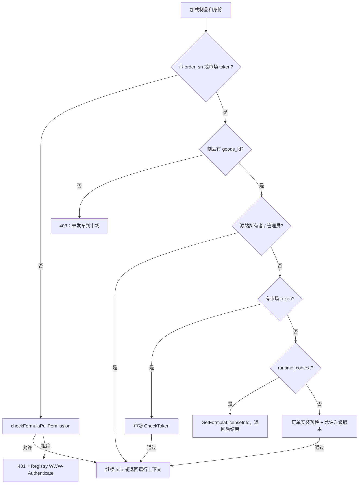

# 制品权限与安装详情流程（respo）

本说明记录当前制品公私设置、仓库认证、市场授权及 `Formula.Info` 的调用流程。`Info` 同时服务安装、升级、制品详情、完整 manifest 导入和已安装应用授权信息查询；不同模式的返回值不能互相作为授权凭据。

通用资源模型和权限继承见 [Registry 公共资源与权限](../registry/README.md)。Chart 生成规则见 [制品与 Helm 打包契约](../../APPLICATION_HELM_PACKAGING.md)，市场商品发布见 [市场商品发布说明](../../MARKET_GOODS_PUBLISHING.md)。

## 代码导航

| 位置 | 职责 |
| --- | --- |
| [provider.go](provider.go) | 路由、中间件、推送事件、迁移命令与后台打包初始化 |
| [http/controller/formula.go](http/controller/formula.go) | `Info` 编排、版本选择、manifest / 附件响应、ticket；安装完成及卸载回调 |
| [http/controller/formula_install_detail.go](http/controller/formula_install_detail.go) | 权限场景分流、市场订单校验、安装表单与启动参数 |
| [http/controller/formula_permission.go](http/controller/formula_permission.go) | 制品公私 get/set、`checkFormulaPullPermission` |
| [http/controller/formula_notice.go](http/controller/formula_notice.go) | 市场授权错误、绑定冲突、HTML 与旧版纯文本提示 |
| [logic/formula/depot.go](logic/formula/depot.go) | 创建、加载、删除制品，本地文件与数据库元数据 |
| [logic/formula/depot_oci.go](logic/formula/depot_oci.go) | OCI 发布、拉取及附件恢复 |
| [logic/formula/ticket.go](logic/formula/ticket.go) | 安装 ticket 编解码及字段校验 |
| [logic/zpkmarket/order.go](logic/zpkmarket/order.go) | 市场安装 / 升级预检、授权信息、允许版本、核销与解除占用 |
| [logic/zpkmarket/dependency_release.go](logic/zpkmarket/dependency_release.go) | 依赖应用订单与 release 绑定 |
| [logic/zpkmarket/cluster_support.go](logic/zpkmarket/cluster_support.go) | 分类对应的集群支持范围 |
| [logic/zpkmarket/helm_options.go](logic/zpkmarket/helm_options.go) | 市场绑定、菜单等动态 Helm 选项 |
| [logic/helm/helm_dynamic_pack.go](logic/helm/helm_dynamic_pack.go) | 按变换参数缓存动态 Helm 包 |
| [../../common/service/w7/permission/client.go](../../common/service/w7/permission/client.go) | 资源、namespace、用户授权及 Check 的服务间 SDK |
| [../../common/service/w7/zpk-market/service.go](../../common/service/w7/zpk-market/service.go) | 市场签名请求和响应类型 |
| [command/migrate_namespace.go](command/migrate_namespace.go) | 旧 namespace 的权限与全部 OCI 版本迁移 |

`respo` 通过 PermissionSdk 管理资源和授权；权限表、namespace、Registry token 的具体实现归 `app/registry`。迁移命令允许直接操作旧数据，不代表日常制品业务可以越过 SDK 操作 Registry 表。

## 资源标识、公私与用户授权

制品复用自身 OCI repository 的权限，不另建一套应用授权表。资源格式为：

```json
{"type":"repository","value":"app/w7_demo"}
```

路径由 `common/logic.GetFormulaOciName` 生成：读取 `setting.depot.oci_namespace`（当前使用 `app`），制品标识转小写并把 `-` 转成 `_`。例如制品 `w7-demo` 对应 `app/w7_demo`；资源值不包含域名、版本或 tag。

公私与用户授权分开保存：

| 内容 | 所属模型 | 操作 |
| --- | --- | --- |
| namespace | `RegistryNamespace` | PermissionSdk 的 namespace 方法 |
| repository 所有者及 `visible_type` | `RegistryRepository` | `GetResource` / `SetResource` |
| 用户的 `pull/push` 动作 | `RegistryUserPermission` | `Add` / `Delete` / `Clear` |

新建制品的 `Depot.AddFormula` 依次确保 namespace 存在、设置资源为 `visible_type=4`（公有读私有写），再为创建者添加 `pull,push`。这些远程调用与制品本地文件 / 数据库创建不是一个跨服务事务，不能把失败理解为所有步骤都已回滚。

### 基础信息中的公私设置

| 接口 | 参数 | 行为 |
| --- | --- | --- |
| `POST /zpk/respo/permission/get` | `identifie` | 获取对应 repository 状态；跟随 namespace 时读取 namespace 状态，按界面公有 / 私有返回 |
| `POST /zpk/respo/permission/set` | `identifie`、`visible_type` | 只接受 `1` 私有或 `4` 公有读私有写，通过 `SetResource` 设置资源 |

这两个接口经过登录和域名限制，并用当前用户加载制品以限制管理访问。修改公私只调整资源状态，不用添加 / 删除匿名授权实现，也不替换已有用户授权。

私有表示匿名不能 pull；具体用户是否允许仍走公共权限规则：先判断资源公开动作，再判断当前用户精确授权，再按既有规则决定 namespace 用户授权是否可兜底。对 pull 和 push 的继承差异详见 Registry README。资源记录的 owner 字段与用户授权是两个概念，创建时需显式授予所有者动作。

公私状态覆盖 repository 内的所有版本，不按版本分别设置。已有 Registry token 在有效期内仍按其签发 scope 校验，改公私不等于立即撤销已签发 token。

## Info 入口与身份

对外路由仍使用历史拼写 `respo`：

| GET 路径 | 含义 |
| --- | --- |
| `/zpk/respo/info/:id` | 按制品标识加载 |
| `/zpk/respo/info/:id/:cid` | 选择包内子应用 |
| `/zpk/respo/v2/info/:id/:version` | 指定版本 |
| `/zpk/respo/v2/info/:id/:version/:cid` | 指定版本及子应用 |

以上路由依次使用可选 ZPK 登录、CloudAccessToken、W7PanelUser、可选 ConsoleUser 中间件，再进入 `Formula.Info`。`:id` 是制品标识，`:version` 是版本字符串，`:cid` 是子应用标识，不是数据库版本 ID。编辑管理的 `Formula.Detail` 是另一个入口，不经过本节的安装响应编排。

`Info` 首先加载制品，然后读取上下文 `console_uid`；仅在已有 `appid` 上下文且 UID 尚为空时，才使用请求的 `console_uid`。目标面板用户 ID 不能直接作为源 ZPK 的本地用户 ID 使用。

### 凭据用途不能混用

| 凭据 | 使用位置 | 用途 |
| --- | --- | --- |
| ZPK 登录 JWT | `X-Zpk-Token` | 在源 ZPK 建立本地用户身份 |
| Registry Bearer token | `Authorization: Bearer …` | 证明指定 repository 的 pull scope |
| 市场临时安装 token | Info 查询参数 `token` | 市场后台审核 / 测试安装，由市场检查 |
| 市场订单 | `order_sn` + 控制台身份 | 购买用户安装 / 升级、运行授权信息查询 |
| 安装 ticket | 安装完成 / 卸载回调 | 携带预检产生的制品、版本、订单与绑定上下文 |

## 仓库与市场授权如何分流

`authorizeFormulaInstallDetail` 以 `order_sn != "" || token != ""` 判断市场请求；不是根据请求来自本集群还是其他集群来决定权限。



上述 helper 返回 `false` 代表错误或运行上下文响应已经结束；调用者不能再生成安装响应。市场订单分支还要求有效控制台 UID，缺失时返回 401。

### 普通仓库访问：标准 Registry 流程

`checkFormulaPullPermission` 区分本地登录和外部访问：源站管理员按业务规则放行；其他已登录 ZPK 用户通过 `PermissionSdk.Check` 校验自身的仓库 pull 授权（包括所有者初始化授权和既有 namespace 继承），保持制品库内部详情、编辑等请求可用。`X-Zpk-Token` 不作为 Registry token 使用。

匿名和外部 Registry Bearer 请求不调用权限 Check API，直接 GET `registry_cli.default.url` 下的 `/v2/<repository>/tags/list?n=1`，携带请求中的 Bearer token，由 Registry 验证对应仓库的 pull；不使用服务端默认仓库账号密码。该路径不依赖某个具体 tag（例如 latest）存在。Registry 返回 200 才放行；返回 401 时校验并透传其实际 `WWW-Authenticate`，realm、service 和 scope 不再由 info 拼接。网络失败、非 200/401 或无效 challenge 返回 503。权限不足的响应例如：

```http
WWW-Authenticate: Bearer realm="https://registry.example.com/zpk/v2/registry/auth",service="docker-registry",scope="repository:app/w7_demo:pull"
```

跨集群安装客户端收到 challenge 后，用源仓库账号密码通过 Basic Auth 请求 realm，申请相同 scope 的 token，再携带 Bearer token 重试原 Info。可复用目标面板保存的仓库 Secret，但账号必须在源仓库具备该资源或按现有继承规则取得的 pull 权限。目标集群的登录本身不授予源仓库权限。

### 市场请求：后台 token 或购买订单

市场请求不再叠加普通仓库 pull 校验，但要求制品已关联商品。源站所有者 / 管理员保留管理豁免；其他请求：

1. 有 `token` 时调用 `ZpkMarketSdk.CheckToken`；用途是市场管理后台审核 / 测试安装，不是普通购买用户的订单凭据。此分支优先于订单分支。
2. 没有 token 且 `runtime_context=true` 时，调用 `GetFormulaLicenseInfo` 获取授权信息并立即返回，不执行安装预检、不生成安装下载数据。
3. 普通订单安装 / 升级进入 `resolveFormulaInstallOrder`，先 `CheckFormulaCanInstallOrUpgrade` 验证用户、商品、订单、升级 / 重装、域名和应用标识。
4. 试用到期、退款限制、未购买等按原提示协议结束；域名 / 应用标识绑定冲突使用 HTTP 409。
5. 预检通过后应用市场返回的订单号，再查询 `GetFormulaCanUpgradeVersion`，取得允许版本、服务到期状态及可能切换的制品。返回的新订单号继续用于依赖、ticket 和响应地址。

运行信息的对外 API 地址仍为 `/zpk-market/order/install-info`，SDK 方法名为 `GetOrderLicenseInfo`。`CheckToken`、订单安装预检、授权信息查询各有用途，不因名称相近而替换调用。

## 从授权到安装响应

`Formula.Info` 在授权通过后按以下顺序继续：

1. **切换订单绑定制品。** 市场返回不同制品标识时重新加载，并将当前版本上下文更新为该制品版本。
2. **选择版本。** 有 `cur_version` 且升级时通过 `Version.FindNextUpgrade` 选择下一可升级版本；非升级时查当前制品中指定的已发布版本。未找到时尝试市场允许版本，再回落到制品最新版本记录。需要切换实际版本时重新加载 manifest。
3. **获取集群支持范围。** 按市场分类等信息调用 `GetFormulaClusterSupport`，失败终止。
4. **准备下载 URL。** 获取后端包地址及前端包 token 映射；这一过程可能产生恢复、签名或临时映射等副作用。
5. **选择响应 manifest。** 默认根应用；指定 `cid` 时选择对应子应用。根应用会查询依赖订单绑定，并通过 `ConfigureManifestExternalDependencies` 写入本次响应的依赖配置。
6. **组装安装表单。** 调用 `buildFormulaInstallInfos`，收集主子应用参数、Ingress、端口、volume 和必选状态。
7. **生成 ticket 及响应。** 将最终制品、版本、类型、控制台 UID、订单、升级 / 重装、domain 和 app_identify 写入 ticket；构造带订单上下文的 `info_url` 和市场动态 Helm 选项，返回安装详情。

该流程跨数据库、本地文件、OCI 和市场，不是纯数据库查询或统一事务。`Depot.GetFormula` 本身可能恢复缺失附件；不能因为调用名是 Info 就认定没有存储副作用。

### 启动参数处理

`buildFormulaInstallInfos` 仅在未传 `cid` 时返回主子应用列表；传 cid 时该列表为空，响应 manifest 仍按子应用选择。根应用默认必选，子应用的 `required` 来自根 manifest 的 `platform.depends`。

`buildFormulaInstallStartParams` 按顺序处理：

1. `ResolveStartParamAppReferencesCopy` 根据全部 manifest 解析 `module_name` / 包内应用引用，使用副本避免污染原始启动参数。
2. 非 StorageDevice 存储模式下，对带 PVC volume 且缺少 `PVC_NAME` 的应用补齐该参数；已有同名参数保留。
3. 暂时把非空 `options` 转成 `|` 拼接的 `values_text`，适配现有安装端；空参数数组序列化为 `[]`。

Ingress、端口、volumes 分别取对应应用，避免子应用误用主应用的端口或卷。这里负责安装表单定义和引用，真正的参数取值、依赖选择及 Kubernetes 渲染在安装端与 Chart 模板完成。

## 返回模式与下载边界

| 模式 / 字段 | 内容与边界 |
| --- | --- |
| 普通 Info | manifest、版本、安装表单、包地址、ticket、商品 / 服务及集群支持信息 |
| `full_manifest=true` | 额外返回 `child_manifests/helm_urls/zip_urls`，供完整导入；保留完整 manifest，不按普通响应裁剪 |
| `runtime_context=true` | 只返回 `title/dynamic_values`，包含授权状态和 `validate`；不授予安装权限 |
| `helm_url` | 打包后的根 Chart 下载地址；不能塞进描述各应用原始附件的 `helm_urls` |
| `info_url` | 使用最终制品标识，保留规范化后的 `order_sn`；不是安装授权 ticket |
| `service_expire` | 市场返回的到期状态，不能仅凭此字段替代安装预检结果 |

完整 manifest 会设置协议版本为 3；普通序列化删除旧 `platform.container`，完整导入响应保留。没有市场 Binding 时使用原 Helm 包；有变换时按原包状态与变换参数缓存动态包，不覆盖原包。普通安装响应附 `Cache-Control: no-store`。

当前制品权限关口位于 Info。下载接口没有再叠加同一套仓库 / 订单认证，而是按现有下载 token、签名及文件映射机制提供文件；不能把它描述为“每次下载重新验证仓库权限”。内存映射型下载 token 命中后会删除映射，重试可能需要重新获取 Info；后端源码包还存在稳定签名地址。

### 安装完成与卸载

- `POST /zpk/respo/install/complete-notify`：解析 ticket，使用其中最终订单、制品版本、升级 / 重装及 domain/app_identify 等上下文调用市场 `UseOrder`，同时传面板 URL 和设备标识。
- `POST /zpk/respo/uninstall/complete-notify`：解析 ticket 后调用 `DiscardUsedOrder`，解除占用。
- 无控制台 UID 或订单时，市场逻辑有无需远程调用的分支。

ticket 是预检上下文的载体；安装客户端仍需按既有流程完成安装和回调。绑定冲突的强制重装只用于允许的非升级场景，不能通过按钮展示或运行授权信息绕过后端校验。

## 错误与 HTML 提示

纯文本、HTML 能力协商、市场错误分类和绑定冲突统一沿用 [根 README 的安装授权 HTML 提示](../../README.md#安装授权-html-提示)：

- 仅 `notice_format=html` 启用约定的授权 HTML，返回 JSON 中的 `data.html`，不是 text/html 页面。
- 试用、购买、VIP、退款等授权限制与网络、签名、解析、数据库异常分开；不把所有失败转换成购买提示。
- 绑定冲突保持 HTTP 409 及结构化字段；升级不提供强制重装按钮。
- ZPK 生成业务文案和允许动作，面板负责协议转发、净化、展示及本地重装确认。HTML 不能代替授权结果。

## 旧制品迁移

`respo:migrate-namespace` 将旧 `zpk_oci` 权限和全部 OCI 版本迁往 `app`，可用 `--identifie` 限定制品。当前主流程从 `app` 读取，不在 Info / 下载时自动回退旧 namespace。

命令保留旧数据，跳过目标已有版本；源 OCI manifest 不存在时记录并跳过，其他错误按命令实现返回。迁移代码允许直接读写 Registry 表，日常 SDK 边界不变。当前仍会写 `w7.cc/migrated-from` 并清除自动发布标记；推送回调遇到迁移标记会跳过后续版本创建、本地版本文件清理及自动发布。

本段描述当前实现，执行命令会访问真实数据库及 OCI，阅读或修改文档不代表已执行迁移。

## 验证入口

```sh
go test ./app/respo/http/controller ./app/respo/logic/formula ./app/respo/logic/zpkmarket
go test ./app/registry/logic/common ./app/registry/logic/repository
```

启动参数引用、副本、PVC、Ingress、端口、ticket 等回归见相关包的 `*_test.go`。SDK 测试在 `common/service/w7/zpk-market`，迁移测试在 `app/respo/command`；执行这些测试时需区分现有商品测试缺失符号等编译问题与本次修改。测试命令是验证入口，不代表文档更新时已经全量运行或完成跨集群安装验证。
