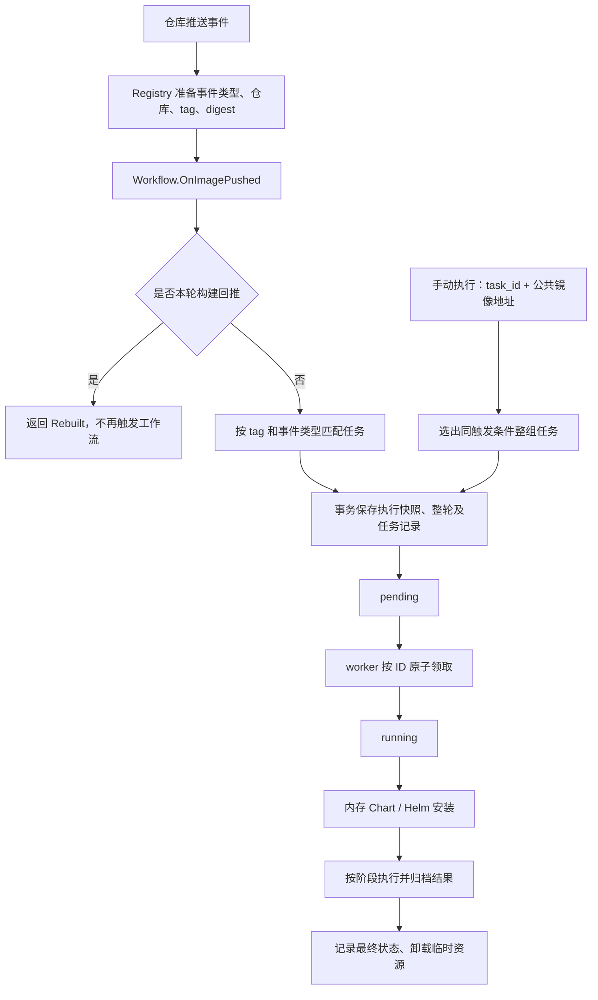

# 镜像自动任务（Workflow）

Workflow 负责保存任务、匹配触发条件、排队执行、归档结果。镜像仓库是当前调用方：仓库页面传入镜像地址，推送事件传入仓库路径、tag、digest 和事件 ID。日常配置与执行按工作流自身的数据处理，不再查询镜像仓库的所属用户。

## 目录与职责

| 位置 | 职责 |
| --- | --- |
| [provider.go](provider.go) | 注册接口、补齐数据库字段、迁移旧规则、启动执行器 |
| [http/controller/workflow.go](http/controller/workflow.go) | 配置、手动执行、分页记录与日志；按规则所有者校验访问 |
| [http/controller/deploy.go](http/controller/deploy.go) | 集群命名空间、工作负载、容器查询及代理 |
| [logic/config.go](logic/config.go) | Config / Task 模型、配置校验、自动匹配、手动选择整组任务 |
| [logic/workflow.go](logic/workflow.go) | 规则读写、快照、入队、构建回推识别、记录和日志 |
| [logic/executor.go](logic/executor.go) | 扫描队列、原子领取、执行参数、结果归档和中断超时处理 |
| [logic/helm.go](logic/helm.go) | 生成内存 Chart、安装、阶段采集回调、卸载 |
| [logic/helm_templates/](logic/helm_templates/) | Job、Dockerfile、认证 Secret、RBAC 与结果 ConfigMap 模板 |
| [logic/deploy.go](logic/deploy.go) | KUBECONFIG 校验、加解密及集群操作 |
| [logic/migrate.go](logic/migrate.go) | 旧规则 / 日志迁移和旧域名查询键规范化 |
| [../../common/service/taskqueue/queue.go](../../common/service/taskqueue/queue.go) | 有界 channel、ants worker 池、进程内排队及执行去重 |
| [../../ui/src/components/workflow/image-tasks.vue](../../ui/src/components/workflow/image-tasks.vue) | 任务配置、执行顺序、手动执行、分页记录和日志弹窗 |

Provider 在 [main.go](../../main.go) 中独立注册。模型及生成查询仍统一放在 `common/entity`、`common/dao`；不建立单独的 Workflow 主表。

## 保存任务：保存什么，何时读取

仓库页面使用 `image_repository` 传完整仓库地址，不含 tag、digest，例如 `registry.example.com/cache/oowy/systemd`。后端取路径 `cache/oowy/systemd` 作为规则查询键，域名不参与规则关联。

保存流程：

1. 读取已有规则；不存在时使用当前登录用户作为所属用户。已有规则只能由所有者或管理员管理；全部任务删除后，仍可从历史执行快照恢复所属关系。
2. 控制器把已确定的仓库配置写入 `config.repository`，客户端不能借此改所属用户或仓库凭据。
3. 校验任务、阶段、镜像来源和部署目标；当前集群部署只允许管理员配置。
4. 从服务配置读取默认仓库账号密码；含构建任务时要求凭据完整。密码、目标集群 KUBECONFIG 加密后保存。
5. 在事务内按稳定任务标识更新 / 新增规则，删除本次配置中已移除的规则。保存空任务列表表示删除规则，不删除历史执行记录。

| 数据 | 保存位置 / 获取时间 |
| --- | --- |
| 所属用户、目标仓库路径 | 规则的 `user_id`、`repository_name` |
| 任务动作、触发条件、阶段、来源、Dockerfile、输出后缀、部署目标 | 每个任务对应一条规则 |
| 仓库账号密码 | 保存配置时读取 `registry_cli.default.username/password`；密码加密落库 |
| 目标 KUBECONFIG | 保存规则时加密；查询配置时为有权用户解密返回 |
| 本轮任务配置、凭据及输入镜像 | 触发时写入加密执行快照；后续编辑规则不改变已入队快照 |
| 本地仓库域名和 HTTP 配置 | 执行时读取当前 `registry_cli.default.external_domain` 与 `registry_cli.default.url` |
| 执行镜像和 Helm 模板 | 执行时使用当前服务配置及当前程序内置模板 |

改仓库域名不需要修改规则。排队中的自动输入地址和本轮输出仓库会使用执行时的本地域名；手动输入的外部源镜像保持原地址。账号密码使用保存值，调整服务默认凭据后，需要重新保存规则才能让新触发使用新凭据。

## 触发与数据流



### 自动触发

Registry 在自己的适配层查询仓库 / tag，区分新增和更新，再调用 `Workflow.OnImagePushed`。Workflow 读取自身规则，使用推送事件的 digest 作为源镜像引用。

触发条件如下：

| 字段 | 含义 |
| --- | --- |
| `deploy_type=1` | 更新版本；`tag_name` 按逗号分隔后精确匹配，忽略 `match_type` |
| `deploy_type=2, match_type=1` | 新增版本；`tag_name` 按逗号分隔，支持精确或前缀匹配 |
| `deploy_type=2, match_type=2` | 新增版本；按正则匹配 |

没有命中任务不产生执行记录。事件 ID 与不含域名的仓库路径计算出稳定 `run_id`，数据库唯一约束防止同一事件重复入队。入队只持有短事务，不在事务中执行 Helm 或拉取镜像。

构建回推按保存的账号、正在执行的目标 tag，以及已记录的输出 tag / digest 识别，避免构建结果再次触发自动任务。Workflow 返回 `ImagePushResult.Rebuilt`，由 Registry 更新 tag 表的 `is_rebuilt`。外部推送会清除当前 tag 的重构标记，历史产物记录保留。多个来源使用同一账号并发推送同一个目标 tag 时，仅凭 Webhook 用户名不能严格区分来源。

### 手动触发

任务行点击“手动执行”，弹框输入公共镜像地址，并列出本次整组任务。后端：

1. 验证规则访问权限，解析输入地址；省略 tag 使用 `latest`，不接受 digest 引用。
2. 根据所选 `task_id` 找到触发条件完全相同的任务组；输入 tag 无需匹配自动条件。
3. 保留该组的阶段、并行及来源关系；组内有当前集群部署时，仍要求管理员执行。
4. 保存快照并入队，立即返回 `run_id`。不提前请求源仓库、不解析源 digest、不等待实际执行。

输入直接交给 Kaniko / 部署任务。当前界面不提供外部源仓库登录配置；只支持公共输入镜像。构建输出推送到当前规则的目标仓库，输出 tag 为“输入 tag + 任务后缀”；后缀为空时覆盖对应 tag。每次手动提交生成独立执行轮次。

## 阶段、镜像来源与界面

任务编辑负责名称、触发条件及执行动作；新任务默认第 1 组、使用原始镜像。列表通过“调整执行顺序”统一修改阶段和使用镜像：

- 相同 `stage` 的任务在同一个 Job 的不同容器中并行；不同阶段按 Helm hook 权重串行。
- 当前阶段全部成功才进入下一阶段；失败会停止后续阶段，同阶段已启动的任务继续执行。
- `source=original` 使用触发输入。`source=task` 必须指定同触发条件下、更早阶段的构建任务，并使用其实际输出 digest。
- 触发组按 `deploy_type`、有效的 `match_type` 和去除首尾空白后的 `tag_name` 比较；两个条件恰好命中同一 tag，不代表属于同一组。
- 来源任务未命中时记录失败，不自动改用原始镜像。
- 同阶段不能输出相同 tag，也不能修改同一部署容器；不同阶段可连续修改同一目标。输出后缀始终基于触发 tag，不逐层叠加。

顺序弹框使用独立草稿，取消不改已保存配置。修改阶段后，已失效的构建来源会在草稿中改回原始镜像；保存成功后才生效。新增、修改、删除或调整顺序均提交完整配置。

每个工作流最多 32 个任务。构建只接收 Dockerfile 片段，不支持 `FROM`、`ONBUILD`、`ADD`、`COPY` 或自定义 frontend；源镜像的 `FROM` 由执行模板生成。

## 排队、并发与状态

| 服务配置 | 环境变量 | 服务 Chart | 默认值 |
| --- | --- | --- | --- |
| `workflow.enabled` | `WORKFLOW_ENABLED` | `workflow.enabled` | `true` |
| `workflow.concurrency` | `WORKFLOW_CONCURRENCY` | `workflow.concurrency` | `3` |
| `workflow.queue_size` | `WORKFLOW_QUEUE_SIZE` | `workflow.queueSize` | `100` |
| `workflow.build_image` | `WORKFLOW_BUILD_IMAGE` | `workflow.buildImage` | 模板默认 Kaniko 镜像 |
| `workflow.deploy_image` | `WORKFLOW_DEPLOY_IMAGE` | `workflow.deployImage` | `registry.cdn.w7.cc/alpine/k8s:1.33.0` |

执行器启动后扫描 pending 记录，随后约每 5 秒继续扫描。只有整轮记录的数据库 ID 进入有界队列，进程内去重覆盖排队和执行；worker 开始时以 `pending → running` 条件更新原子领取，避免多实例重复执行同一轮。

`concurrency=3` 表示每个服务进程最多同时执行三轮，组内并行任务数由阶段配置决定。同一仓库的不同轮次允许并发，执行期间不持仓库锁。因此多轮同时写相同 tag 或部署目标仍可能互相覆盖。

| 状态 | 含义 |
| --- | --- |
| `pending` | 已入库，等待领取 |
| `running` | 已领取；任务记录在本轮领取时一并进入此状态，不代表容器已经启动 |
| `succeeded` | 已确认成功 |
| `failed` | 匹配、执行失败或超时中断 |
| `skipped` | 最终采集确认任务未启动 |
| `unknown` | 无法确认任务执行结果 |

整轮以执行器结果收尾；任务以容器退出状态和已完成 hook 为依据，流程失败不会覆盖已确认成功的任务。单阶段最长 30 分钟，一轮最长 2 小时。超过 3 小时未更新的 running 记录标为失败，不自动重放已有副作用；pending 记录可在重启后重新发现。

## Helm、凭据与资源清理

执行时从快照生成内存 Chart，不生成或缓存本地 tgz。Helm 安装、采集、卸载共享同一轮的 `memory` release 存储，不创建 Helm release Secret，因此不会因该 Secret 被面板识别成应用。模板中的普通认证 Secret 仍会创建。

- 执行命名空间固定为 `default`；部署目标使用任务的 `k8s_namespace`。
- 执行器通过 `rest.InClusterConfig` 使用服务 ServiceAccount，不读取开发机器的 kubeconfig。
- 仓库账号密码通过 values 交给模板生成 Docker auth Secret，挂载 `/kaniko/.docker`，走正常 Registry 认证；不签发专用拉取令牌，不使用宿主 Docker socket。
- 远端 KUBECONFIG 通过模板生成 Secret，挂载 `/target/config`；只接受内嵌凭据，不执行外部认证程序、不引用本地凭据文件。
- 当前集群部署使用显式 API 地址、ServiceAccount CA 和 token；第三方部署显式使用 `/target/config`，不依赖镜像内默认 kubeconfig。
- 任务账号按模板获得结果 ConfigMap 及所需工作负载权限；ZPK 服务账号需具备创建、清理本轮 Job、Secret、ServiceAccount、Role、RoleBinding 等资源及读取 Pod 日志的权限。

每阶段完成后先归档结果及日志，避免前面阶段的 Job 被 TTL 删除后丢失记录。Job 完成后保留 60 秒；整轮结束最终采集，再卸载普通资源及内存 release。进程异常退出可能留下 Secret、ConfigMap 等普通资源，Job TTL 不负责清理它们；现有流程不提供自动补偿回滚。

## 数据与迁移

复用 `RegistryRepositoryDeployRule` 和 `RegistryRepositoryDeployRuleMatchLog`：

| 数据 | 关键字段 |
| --- | --- |
| 任务规则 | `workflow_task_key` 稳定任务标识；`execution_order` 阶段；`source_build_task_key` 来源构建任务 |
| 整轮记录 | `workflow_run_id` 非空，`workflow_task_key` 为空；保存触发输入及加密快照 |
| 任务记录 | 同一 `workflow_run_id`，非空 `workflow_task_key`；通过 `rule_id` 关联原规则 |
| 构建产物 | `build_output_tag`、`build_output_digest` |
| 当前 tag 重构状态 | Registry 自己维护的 `ims_registry_repository_tag.is_rebuilt` |

不额外保存 WorkflowID、Chart 路径、包二进制或 selected 列；本轮选中任务由任务日志推导。规则不再读写历史 `image_repository`、`image_host`、`plain_http` 列。

非 debug 且允许写入时，Provider 补齐缺失字段和索引，再执行 `MigrateWorkflowRules`。只有旧规则迁移会查镜像仓库表，补齐所属用户、路径、任务字段并迁移日志；成功后清零旧 RepositoryID，失败保留重试依据。已迁移日志的旧完整域名查询键也会转为路径，原规则 / 日志 ID 及历史快照保留。结构补齐不主动删除历史列；迁移失败会阻止 Provider 正常启动。

密码、快照和 KUBECONFIG 使用现有加密机制。备份与多实例部署需保持 `setting.secret` 一致，密钥变化后的解密失败不会回退成当前集群或明文。

## 接口与日志

以下均为 POST，前缀 `/zpk/v2/api/workflow`，经过 CORS、域名限制和登录中间件；请求带 `image_repository`，后续按规则 / 历史快照的所有者校验，管理员可访问全部规则。

| 路径 | 额外参数 | 返回内容 |
| --- | --- | --- |
| `/get` | 无 | `config` |
| `/save` | `config` | 保存结果；新增、编辑、删除统一提交任务列表 |
| `/run` | `task_id`、`image` | `run_id`，表示已入队 |
| `/runs` | 可选 `task_id`、`page`、`page_size` | `list/total/page/limit`；省略 task_id 查询整轮记录 |
| `/logs` | `run_id`、`task_id`、可选 `tail_lines` | `log/archived/truncated/status` |

`page=1`、`page_size=10` 为默认值，单页最大 100；日志默认 100 行，最大 2000。集群查询仍在 `/zpk/v2/api/repository/deploy_rule/k8s/{namespaces,apps,app-containers}`，代理为 `/proxy/*path` 且限管理员。旧 deploy_rule 增删改查接口已移除。

任务行的“执行记录”按任务分页；日志弹框使用该记录的 run_id + task_id，只看当前任务。界面支持行数选择、全屏及跟踪；跟踪在上次请求完成 3 秒后刷新，关闭弹窗、切换或卸载时取消旧请求和定时器，错误时暂停。

终结且已归档的结果直接查数据库。Pod 尚在时实时读取每个容器最多 1 MiB 日志；归档仅保留每个容器末尾 100 行、最多 16 KiB，Pod 清理后不能通过选择更多行恢复。归档响应会标记 `archived` 并停止跟踪；这是执行摘要，不是全量日志服务。

## 验证入口

```sh
go test ./app/workflow/... ./common/service/taskqueue ./app/registry/logic/repository
go test -race ./app/workflow/... ./common/service/taskqueue
go vet ./app/workflow/...
```

相关回归分布在 `logic/*_test.go`、`http/controller/manual_test.go`，覆盖手动整组选择、阶段、来源、输出冲突、快照、迁移、域名变化、领取并发与推送识别。模板相关测试需要本机 Helm。单测和模板渲染不等于真实 Kaniko 构建或集群部署验证。
